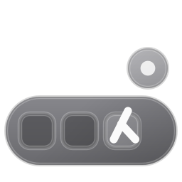
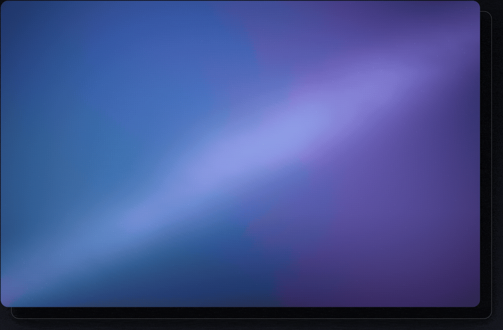

#+title: lambdock
#+subtitle: a dock whose configuration is a Scheme program
#+author: Josep Jesus Bigorra Algaba
#+email: jjbigorra@gmail.com
#+language: en
#+options: toc:nil num:nil html-style:nil
#+HTML_HEAD: <link rel="stylesheet" type="text/css" href="https://jointhefreeworld.org/static/css/jointhefreeworld.css" />

[[https://jointhefreeworld.org/ggg/dist/lang-c.svg]] [[https://jointhefreeworld.org/ggg/dist/gtk4.svg]] [[https://jointhefreeworld.org/ggg/dist/scheme-guile.svg]] [[https://jointhefreeworld.org/ggg/dist/build-meson.svg]] [[https://jointhefreeworld.org/ggg/dist/gnu-guix.svg]] [[https://jointhefreeworld.org/ggg/dist/nix-flake.svg]] [[https://jointhefreeworld.org/ggg/dist/maak.svg]] [[https://jointhefreeworld.org/ggg/dist/i18n-gnu-gettext.svg]]
[[https://img.shields.io/badge/license-MIT-2ea44f.svg]] [[https://jointhefreeworld.org/ggg/dist/jointhefreeworld-org.svg]] [[https://img.shields.io/badge/CI-Byggsteg%20%7C%20Woodpecker-2ea44f.svg]]

#+attr_html: :width 160 :alt lambdock logo

/An ordinary dock is a compiled artefact with a settings dialog in front of it.
lambdock is a small C renderer driven by a Guile image: the dock on screen is the
fixed point of a Scheme program you can rewrite while it runs./

~lambdock~ puts a strip of launchers on an edge of a GNU/Linux desktop, shows
which applications are running, and brings their windows back when you click
them.  The rendering core -- GTK4 widgets, ~gtk4-layer-shell~ anchoring, the
foreign-toplevel listener, the frame clock -- is C.  The policy layer -- which
items exist, which theme is in force, where the glass shelf sits, what a meter
reads -- is a set of bindings in an embedded *[[https://www.gnu.org/software/guile/][GNU Guile]]* image.  The settings
file is evaluated into that image at start and again on every save; a socket
*[[https://en.wikipedia.org/wiki/Read%E2%80%93eval%E2%80%93print_loop][REPL]]* evaluates forms in the same image, so inspecting the dock and mutating
it are the same operation.

That arrangement is the whole design argument.  A dock is small enough to hold in
one head, and its state is a value; when the configuration language is Lisp, the
value can be computed, composed and replaced at run time instead of serialised
into a file and read back by a parser.  The rest of this manual is the
consequence: nineteen themes as CSS, a theme per look in one line, settings that
take effect on the next frame.

#+name: lambdock-showcase
#+caption: Recorded from a scripted nested niri session by =tools/record-demo/record-demo.sh= (1080 px): auto-hide at the screen edge, the fish-eye under the pointer, launching applications with running indicators, the multi-window popover, the dock's own menu and the Preferences window, a folder stack opened as a grid, the launchpad filtered from the REPL, a live Guile REPL changing the icon size and every theme, and the full-width Luna taskbar.

- 🐑 *Read the source (and send PR/issue/patches):* [[https://github.com/jjba23/lambdock][github.com/jjba23/lambdock]]
- 📦 *Install it:* [[https://build.opensuse.org/package/show/home:jjba23/lambdock][openSUSE Build Service]], [[https://search.nixos.org/packages?query=lambdock][NixPkgs]], Guix, Docker Hub, and the packaged tarballs
- 📚 *Hack on it:* [[file:HACKING.org][the Developer Onboarding & Architecture Guide]]
- 💬 *Ask anything:* [[https://jointhefreeworld.zulipchat.com/#narrow/channel/632484-lambdock][the lambdock Zulip community]]
- 📰 *Follow what changed:* [[file:NEWS.org][the changelog]]
- 🗺️ *Read why it exists:* [[https://jointhefreeworld.org/blog/articles/gnu-linux/quest-for-eternal-dock/index.html][Quest for the eternal dock]]
- ☕ *Support the work:* [[https://bmc.link/jjbigorra][buying me a cup of coffee]]

#+TOC: headlines 1

------------------

* Documentation
:PROPERTIES:
:CUSTOM_ID: documentation
:END:

The guide is split by what you are trying to do:

- *[[file:docs/getting-started.org][Getting started]]* — what lambdock is, what it is built with, and how to install it
- *[[file:docs/using-the-dock.org][Getting to know the dock]]* — launching and focusing, the window popover, stacks, the launchpad, the trash, drag and drop, keyboard and accessibility
- *[[file:docs/configuration.org][Configuring lambdock]]* — the settings file, every option, the item DSL, presets, multi-dock setups and the Preferences window
- *[[file:docs/theming.org][Theming and the shelf]]* — themes, looks, whole-dock recipes, the glass shelf, dock mode, spacing and your own CSS
- *[[file:docs/repl.org][The live REPL]]* — driving the running dock from a Guile REPL, with Geiser
- *[[file:docs/internals.org][How lambdock works]]* — Wayland toplevel tracking, app identity, the C↔Guile bridge, animation, and why Lisp and Guix
- *[[file:docs/development.org][Developing and community]]* — building and hacking with maak, the test suite, translations, community and the changelog
- *[[file:docs/contributing.org][Contributing]]* — reporting, patches, the AI policy, the code of conduct and the etymology

This page keeps the feature list, the licence and the project links.

------------------

* Features
:PROPERTIES:
:CUSTOM_ID: features
:END:

- *Two languages, one process.* Rendering, layer-shell anchoring, protocol
  listeners and the frame clock are C; every decision about what to draw is a
  Scheme value bound in the embedded image.
- *The configuration is a program.* =settings.scm= is evaluated, not parsed:
  every option is a top-level binding, presets are procedures, and the item list
  is an ordinary list you can build with =map=, =filter= and =append=; see
  [[file:docs/configuration.org][Configuring lambdock]].
- *A live image.* A Unix-socket REPL evaluates forms in the running process:
  read state, replace it, and the next frame draws the result; see
  [[file:docs/repl.org#repl][the REPL section]].
- *Wayland native.* Built on GTK4 and ~gtk4-layer-shell~ for edge anchoring,
  cubic-eased slide animation and compositor integration.
- *Foreign-toplevel tracking.* Uses
  ~zwlr_foreign_toplevel_manager_v1~, the Wayland
  [[https://wayland.app/protocols/wlr-foreign-toplevel-management-unstable-v1][foreign toplevel protocol]],
  for running indicators, window titles and a popover that focuses, closes or
  opens individual instances; see [[file:docs/internals.org#toplevel-tracking][Wayland toplevel tracking]].
- *Multi-monitor.* Span the dock across all outputs (~#:monitor 'all~) or bind
  it to one connector (=~\"DP-1\"~); see
  [[file:docs/configuration.org#configuration-options][the options reference]].
- *Auto-hide.* A two-pixel reveal strip at the screen edge, with a
  frame-clock-driven slide that is cancelled if the pointer returns.
- *Fish-eye magnification.* Icons grow under the pointer as a function of
  distance, per item or globally; the mapping is [[file:docs/theming.org][documented with the recipes]].
- *Dock scrolling.* A wheel over a crowded row scrolls it, so the item count is
  not bounded by the screen width.
- *Dynamic widgets.* RAM, CPU, CPU temperature, battery and clock items driven by
  Scheme thunks you can replace with your own pollers.  Meters are drawn as
  icon-sized gauges that fill and change colour, the clock as an analogue face;
  see [[file:docs/configuration.org#dynamic-widgets][Dynamic widgets]].
- *Stacks.* A dock item that opens a folder (Downloads, Screenshots, projects) as
  an icon grid or a list; see [[file:docs/using-the-dock.org#stacks][Stacks]].
- *Launchpad.* A searchable grid of every installed application, built from the
  XDG desktop entries; see [[file:docs/using-the-dock.org#launchpad][The launchpad]].
- *Trash.* A dock item over the freedesktop.org trash layout -- empty and full
  artwork, an item count, open on click, empty from the menu, and files can be
  dropped on it -- so it behaves the same on GNOME, KDE, Xfce, Cinnamon and
  MATE; see [[file:docs/using-the-dock.org#trash][The trash]].
- *Drag and drop.* Reorder items along the row, drag one out to remove it, drop a
  ~.desktop~ file to add an application or a folder to add a stack; the order is
  written to a state file and survives restarts; see
  [[file:docs/using-the-dock.org#drag-and-drop][Rearranging the dock]].
- *Keyboard and screen readers.* The dock, its menus, stacks and the launchpad
  are reachable from the keyboard (arrows, Home/End, Menu, Ctrl+Arrow to
  rearrange), every icon announces name and state, focus rings are visible, and
  reduced motion is honoured from the dock's setting or the desktop's
  accessibility preferences; see
  [[file:docs/using-the-dock.org#accessibility][Keyboard and accessibility]].
- *Nineteen themes, two geometries.* Brushed, Frost, Platinum, Dune, Stage and
  Glass for the glass shelf, Luna, Aurora, Seven, Tiles and Island for the
  taskbar, plus Vanilla, Nature, Solarized and Ambiance -- each with a
  [[file:docs/theming.org#looks][look]] that sets the whole dock in one line, as a floating capsule or a
  full-width taskbar with window titles.
- *Reproducible builds.* A hermetic environment and build from GNU Guix, or a
  pinned flake from Nix, plus Meson/Ninja for a plain source build.
- *Free software.* MIT licensed, documentation included: run it, read it, fork
  it, extend it.

------------------

* Licensing
:PROPERTIES:
:CUSTOM_ID: licensing
:END:

Lambdock and all of its source code are free software, licensed under the
[[https://opensource.org/license/mit][MIT License]].

https://opensource.org/license/mit

The documentation and examples, including this document, which are provided with
Lambdock, are licensed under the same MIT License.

The full license text ships with the project in the file =COPYING=.

------------------

* About this project
:PROPERTIES:
:CUSTOM_ID: about
:END:

- 📦 *Read the source:* [[https://github.com/jjba23/lambdock][github.com/jjba23/lambdock]]
- 📚 *Read the internals:* [[file:HACKING.org][HACKING.org]]
- 📰 *Read the changelog:* [[file:NEWS.org][NEWS.org]]
- 💬 *Talk to us:* [[https://jointhefreeworld.zulipchat.com/#narrow/channel/632484-lambdock][the lambdock Zulip community]]
- ☕ *Support the work:* [[https://bmc.link/jjbigorra][buying me a cup of coffee]]

~lambdock~ is part of the [[https://jointhefreeworld.org/][jointhefreeworld]] family
of small, readable, self-hostable free software, alongside
[[https://codeberg.org/jjba23/byggsteg][byggsteg]],
[[https://codeberg.org/jjba23/lucidplan][lucidplan]] and friends.
