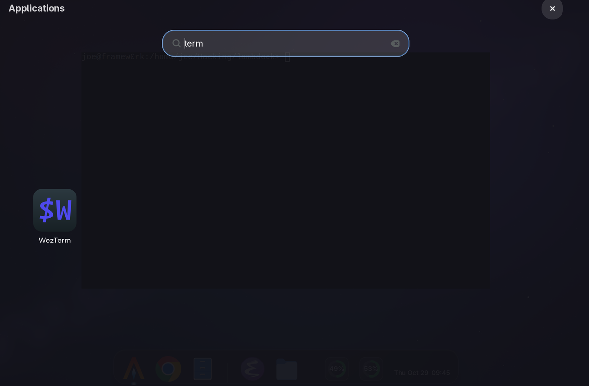
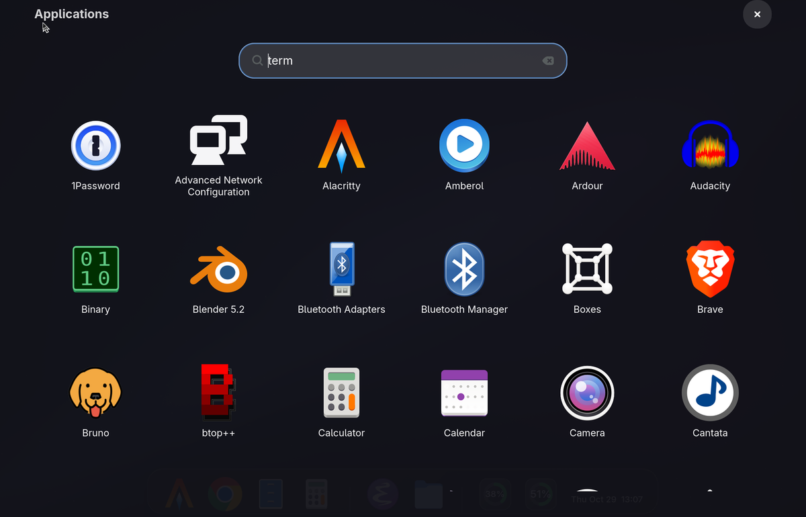
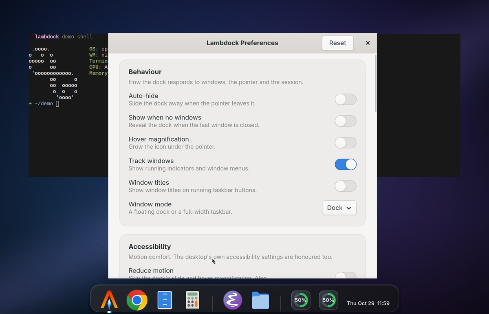
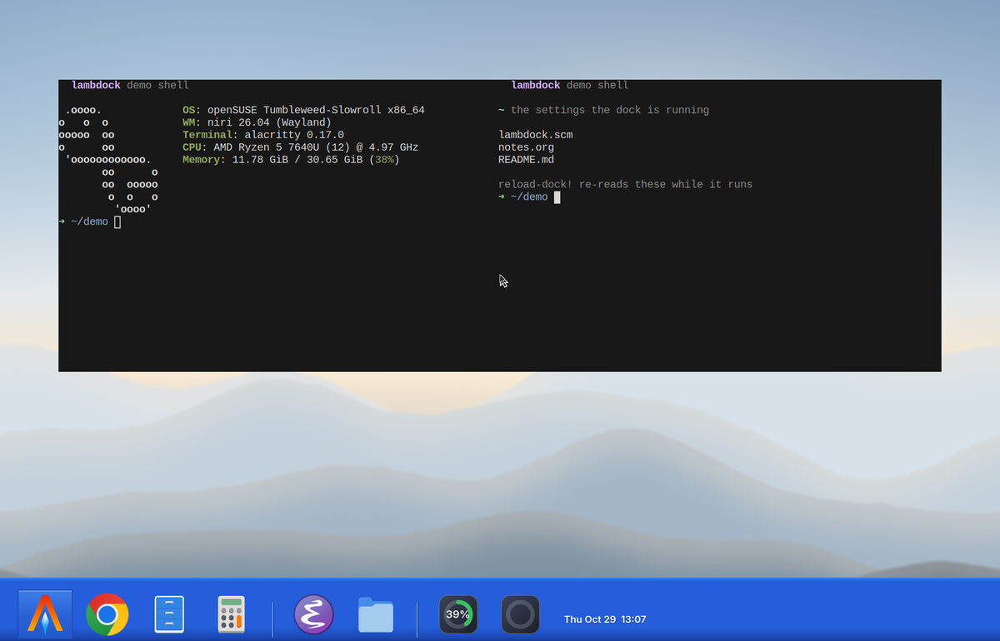

#+title: Getting started
#+author: Josep Jesus Bigorra Algaba
#+email: jjbigorra@gmail.com
#+language: en
#+options: toc:nil num:nil html-style:nil
#+HTML_HEAD: <link rel="stylesheet" type="text/css" href="https://jointhefreeworld.org/static/css/jointhefreeworld.css" />

[[file:../README.org][← lambdock]]

* What lambdock is
:PROPERTIES:
:CUSTOM_ID: what-lambdock-is
:END:

#+begin_quote
~lambdock~ is a modern, hyper-hackable, Wayland-native desktop dock application
(as made popular by CairoDock, the shelf look, Plank) engineered for GNU/Linux users,
people that like docks, desktop refugees, ricers, free software and Lisp
enthusiasts, Wayland minimalists...
#+end_quote

It is built in the C programming language using the GTK4 libraries and toolkit,
~gtk4-layer-shell~, and Lisp (GNU Guile Scheme), with full runtime
inspectability and configurability, hot-reload of the config and of the GTK CSS.

Whether you are running Niri, Sway, Hyprland, River, or any ~wlroots~ / Layer
Shell compliant compositor, ~lambdock~ brings clean application launching,
dynamic Wayland foreign-toplevel window tracking, and smooth cubic-eased
auto-hiding directly to your setup.

** Who it is for
:PROPERTIES:
:CUSTOM_ID: who-it-is-for
:END:

- *People who miss the [[https://en.wikipedia.org/wiki/Dock_(the shelf look)][reference dock]]* --
  and want it on a compositor where windows are told who is in charge.  Fish-eye magnification, a glassy capsule, running
  indicators, window titles: all there, none of it proprietary.
- *Wayland minimalists* who keep a compositor, a terminal, and a small pile of
    well-chosen tools -- and want a dock that does not drag an
  [[https://en.wikipedia.org/wiki/X_Window_System][X11]] toolkit, a configuration
  daemon, or a [[https://www.gnome.org/][GNOME]] session along with it.
- *Ricers and theme collectors*, who will want the nineteen built-in themes, the
  CSS override hook, and the ability to restyle anything on the fly.
- *Lisp people*, who would rather write eleven lines of Scheme than file a
  feature request, and who expect a REPL inside the program they are running.
- *Free software lovers* who want the dock to be theirs: MIT licensed,
  no account, no telemetry, no phone-home.

** What it is built with
:PROPERTIES:
:CUSTOM_ID: what-it-is-built-with
:END:

~lambdock~ is powered by:
*[[https://en.wikipedia.org/wiki/C_(programming_language)][C]]* and *GTK4* /
*[[https://docs.gtk.org/gsk4/][GSK]]* for the graphics core and the
frame-clock-driven animations,
*[[https://github.com/wmww/gtk4-layer-shell][gtk4-layer-shell]]* for the Wayland
surface protocol,
*[[https://www.gnu.org/software/guile/][GNU Guile 3.0]]* embedded in-process through
[[https://www.gnu.org/software/guile/manual/html_node/libguile.html][libguile]],
*[[https://mesonbuild.com/][Meson]]* and *[[https://ninja-build.org/][Ninja]]* for
the build, *[[https://guix.gnu.org/][GNU Guix]]* and
*[[https://nixos.org/][Nix]]* for hermetic, reproducible environments,
*[[https://codeberg.org/jjba23/maak][Maak]]* for the task runner,
*[[https://www.gnu.org/software/gettext/][GNU gettext]]* for translations, and
[[https://www.gnu.org/software/emacs/][Emacs]] (with
[[https://www.nongnu.org/geiser/][Geiser]]) as the recommended way to talk to the
running dock.

There is no scripting bridge to a separate process, no
[[https://en.wikipedia.org/wiki/D-Bus][D-Bus]] daemon in the middle, and no
configuration format to learn in [[https://www.json.org/][JSON]] or
[[https://yaml.org/][YAML]]: the interpreter is inside the dock, and the dock is the
interpreter's playground.

** Glossary: the words in this document
:PROPERTIES:
:CUSTOM_ID: glossary
:END:

New to the Wayland, GTK or Lisp stack?  Every piece of jargon in this document is
one line away.  Skim it now, or come back when a word bites.

| Term                    | What it means                                                                                                                                                     |
|-------------------------+-------------------------------------------------------------------------------------------------------------------------------------------------------------------|
| *Wayland*               | The modern display protocol on GNU/Linux.  [[https://wayland.freedesktop.org/][wayland.freedesktop.org]]                                                         |
| *Compositor*            | The Wayland program that draws windows, positions surfaces and routes input: Niri, Sway, Hyprland, River, Plasma, ...                                             |
| *Layer shell*           | The Wayland protocol for surfaces that belong to the desktop rather than to a window (bars, docks, launchers).  Provided by [[https://github.com/wmww/gtk4-layer-shell][gtk4-layer-shell]].                      |
| *GTK 4*                 | The graphical toolkit ~lambdock~ draws with.  [[https://gtk.org/][gtk.org]]                                                                                       |
| *GSK*                   | The GTK Scene Kit, GTK4's rendering engine.  [[https://docs.gtk.org/gsk4/][docs.gtk.org/gsk4]]                                                                  |
| *GLib / GIO*            | The C utility and I/O library under GTK (file monitors, idle dispatch, process spawning).  [[https://docs.gtk.org/glib/][docs.gtk.org/glib]]                                     |
| *Guile*                 | GNU's implementation of Scheme, and the extension language embedded in ~lambdock~.  [[https://www.gnu.org/software/guile/][gnu.org/software/guile]]                                       |
| *Lisp / Scheme*         | The functional language family this dock is configured in.  [[https://en.wikipedia.org/wiki/Lisp_(programming_language)][Wikipedia]]                                           |
| *S-expression*          | The fully parenthesized syntax of Lisp, which is also the data it manipulates.  [[https://en.wikipedia.org/wiki/S-expression][Wikipedia]]                                   |
| *Thunk*                 | A procedure that takes no arguments; here, what a dynamic widget polls for its text.                                                                             |
| *REPL*                  | Read-Eval-Print Loop: a live prompt where you type code and see the result at once.  [[https://en.wikipedia.org/wiki/Read%E2%80%93eval%E2%80%93print_loop][Wikipedia]]                 |
| *Quasiquoting, macros*  | Lisp facilities for writing code that writes code.                                                                                                               |
| *Foreign toplevel*      | The Wayland protocol that tells a client what windows exist and what they are called.  [[https://wayland.app/protocols/wlr-foreign-toplevel-management-unstable-v1][protocol reference]]                  |
| *Popover*               | A small floating menu anchored to a widget: here, the window HUD.                                                                                                |
| *XDG*                   | The freedesktop.org conventions for where desktop programs keep their files.  [[https://specifications.freedesktop.org/basedir-spec/basedir-spec-latest.html][base directory specification]]              |
| */proc*                 | The pseudo-filesystem where the Linux kernel reports memory, CPU, temperature and battery state.  [[https://en.wikipedia.org/wiki/Procfs][procfs]]                                   |
| *gettext, .po*          | GNU's translation system, and the per-language files it reads.  [[https://www.gnu.org/software/gettext/][gnu.org/software/gettext]]                                           |
| *Meson, Ninja*          | The build system and the build runner.  [[https://mesonbuild.com/][mesonbuild.com]], [[https://ninja-build.org/][ninja-build.org]]                                                            |
| *Guix, Nix*             | Functional package managers that pin every dependency, including the compiler.  [[https://guix.gnu.org/][guix.gnu.org]], [[https://nixos.org/][nixos.org]]                              |
| *Flatpak*               | A sandboxed application packaging format; the ~-flatpak~ presets launch apps through it.  [[https://flatpak.org/][flatpak.org]]                                               |
| *Maak*                  | The Scheme task runner this project builds with instead of a Makefile.  [[https://codeberg.org/jjba23/maak][codeberg.org/jjba23/maak]]                                          |
| *socat, ncat, rlwrap*   | Terminal tools for talking to the socket REPL, the last one adding line editing.                                                                                 |
| *ccls, LSP*             | A C/C++ language server, and the Language Server Protocol editors speak:  [[https://github.com/MaskRay/ccls][ccls]], [[https://microsoft.github.io/language-server-protocol/][LSP]]                                                 |

** Where to start
:PROPERTIES:
:CUSTOM_ID: where-to-start
:END:

|----------------------------------+-----------------------------------------------------------------------|
| *Just want to see it?*           | Watch the GIF above, read [[file:../README.org#features][Features]], then [[#quick-start][Quick start]].                       |
| *New to all of this?*            | Start with the [[#glossary][glossary]], then [[#which-compositors-are-supported][which compositors are supported]].                       |
| *Want it on your desktop now?*   | [[#quick-start][Quick start]] gets a themed dock on screen in under a minute.  |
| *Want to install it properly?*   | [[#installing-lambdock][Installing lambdock]] has Guix, Nix, Meson, distro and container paths. |
| *Want to hack on it?*            | Read [[file:../HACKING.org][HACKING.org]], then [[file:development.org#developing][Developing lambdock]].                        |
|----------------------------------+-----------------------------------------------------------------------|

** Which compositors are supported
:PROPERTIES:
:CUSTOM_ID: which-compositors-are-supported
:END:

~lambdock~ is a GNU/Linux first utility.  It uses ~gtk4-layer-shell~ to render,
position itself, and behave like a dock.  That means it works well in Wayland
compositors that implement the ~wlr-layer-shell-unstable-v1~ protocol, including:

- *Smithay-based compositors*: Niri, [[https://system76.com/cosmic][COSMIC Desktop]]
- *wlroots-based compositors*: [[https://gitlab.freedesktop.org/wlroots/wlroots][wlroots]]
  powers Sway, Hyprland, River, [[https://wayfire.org/][Wayfire]]
- *KDE Plasma* (Wayland session)
- *[[https://mir-server.io/][Mir]]-based compositors*

Note: [[https://en.wikipedia.org/wiki/Mutter_(software)][GNOME (Mutter)]] is
currently not supported, because it does not implement the protocol.

What happens on a compositor *without* layer shell (GNOME, or an X11 session) is
defined, not undefined: ~lambdock~ says so once in the log and then runs as an
ordinary window -- no screen-edge docking, no auto-hide and no exclusive zone,
because those are layer-shell features.  Window tracking is independent of it:
where the compositor implements ~wlr-foreign-toplevel~ (Niri, Sway, Hyprland,
Plasma, ...) running applications and their window menus work; where it does not
(GNOME), the log says that too and the dock keeps its pinned items.

** Why it exists (a note from the author)
:PROPERTIES:
:CUSTOM_ID: why-it-exists
:END:

On the 30th of July 2026, I had a revelation and set out to build ~lambdock~: a
Wayland-native desktop dock that wouldn't just replicate the shelf look or Cairo-Dock
experience, but would transcend it with full runtime inspectability, hackability,
and Lisp enlightenment.

I find GTK to be the very best UI toolkit for GNU/Linux and other platforms,
anno 2026. So for me that choice was pretty clear, even if I also toyed with Qt
and others, but GTK always came on top. After the wreckage of many PoCs and while
reading some HackerNews in bed, a thought crossed my mind, and suddenly,
*absolute clarity*!

Why not use idiomatic modern GTK4, in the language that it's written in. Oh wait,
that language, C, has ~libguile.h~, a great library inter-operability with Lisp
(GNU Guile Scheme), allowing bi-directional bindings and communication. Why not
go down this rabbit hole, which might at the same time teach me more about my
favourite language (GNU Guile) and allow me a frictionless setup with GTK and
native super performance.

#+BEGIN_EXPORT html

#+END_EXPORT

#+begin_quote
I therefore designed lambdock in my mind, in bed, much inspired by Emacs. A
powerful, small C core that powers the program, rendering, graphics and low level
details, and an embedded GNU Guile Scheme engine that at runtime is the heart and
brain of the whole thing. This architecture uniquely delivers interactive socket
REPL control, Lisp metaprogramming macros, dynamic multi-dock spawning, native
Wayland foreign-toplevel window tracking, and frame-clock-driven hover
animations.
#+end_quote

#+begin_quote
~lambdock~ is a story of resilience in many ways, as I cannot even remember how
many attempts I made at building a dock (in different ways). Little did I know
how many paradigms, ideas and PoCs would collapse before my vision became
tangible reality.
#+end_quote

------------------

** Demo recording
:PROPERTIES:
:CUSTOM_ID: demo-recording
:END:

Recording and encoding are separate programs, so the look of the thing can be
iterated without touching the compositor:

#+begin_src sh
./tools/record-demo/encode-demo.sh --raw raw.mkv --events events.tsv --out demo.gif
#+end_src

The storyboard runs twelve scenes: a title card, auto-hide at the screen edge,
fish-eye magnification, launching with running indicators, the window popover,
the dock's own menu and the Preferences window, a folder stack opened as a grid,
the launchpad filtered from the REPL, a live Guile REPL session (icon size, then
eleven built-in themes), the taskbar era XP taskbar mode, and a
closing card.  Each scene is checked frame by frame against its caption before a
recording is published.  See [[file:../tools/record-demo/README.org][tools/record-demo/README.org]] for prerequisites
and options.

Four stills from the same recording, for a closer look:

|       |  |
|  |    |

------------------

** Quick start (the impatient path)
:PROPERTIES:
:CUSTOM_ID: quick-start
:END:

You need [[https://guix.gnu.org/][GNU Guix]] for this path (the other paths are in
[[#installing-lambdock][Installing lambdock]]) and a running layer-shell compositor.

#+begin_src sh
# 1. Get the source
git clone https://github.com/jjba23/lambdock.git
cd lambdock

# 2. Write a settings file
mkdir -p ~/.config/lambdock
cat > ~/.config/lambdock/settings.scm <<'EOF'
(define dock-position 'bottom)
(define dock-theme 'vanilla)
(define dock-auto-hide? #t)
(define dock-icon-size 48)

;; Gap between dock items, in px. 4 is the shelf look dock's (its icons are about
;; 0.3 icons apart); the theme's own button padding/margins add to it.
(define dock-item-spacing 4)
(define dock-items
  (append (preset-launchers-for 'alacritty 'firefox 'emacs)
          (list (separator-item))
          (preset-launchers-for 'ram 'cpu 'clock)))
EOF

# 3. Run it, with every dependency pinned
guix time-machine --channels=channels.scm -- shell -f guix.scm -- lambdock
#+end_src

A themed dock should now be at the bottom of your screen with a few launchers
and three live widgets.  Leave it running, edit =~/.config/lambdock/settings.scm=
in your editor, and save: the dock rebuilds itself where it stands.  Swap
~'vanilla~ for ~'frost~ or ~'luna~ and save again to see the theme
change.

For a whole desktop in one line, replace those sizes and numbers with a
[[file:theming.org#looks][look]]: ~(define dock-look 'platinum)~ brings the theme, the icon
size, the spacing and the glass-shelf geometry together, and
~(define dock-look 'brushed)~, ~'glass-dark~ or ~'luna~ are one word
away.

To get a dock on every monitor, set ~(define dock-monitor 'all)~.  To turn the
dock into a full-width taskbar with window titles, set
~(define dock-mode 'taskbar)~ and ~(define dock-show-window-titles? #t)~.

------------------

** Installing lambdock
:PROPERTIES:
:CUSTOM_ID: installing-lambdock
:END:

*** Dependencies
:PROPERTIES:
:CUSTOM_ID: dependencies
:END:

The project requires the following C and Scheme dependencies:

- *GTK 4* (~gtk4~)
- *GTK4 Layer Shell* (~gtk4-layer-shell~)
- *GNU Guile 3.0* (~guile-3.0~)
- *Wayland development files* (~libwayland-dev~, ~wayland-protocols~,
  ~wlr-protocols~)
- [[https://mesonbuild.com/][Meson]] & [[https://ninja-build.org/][Ninja]], and
  [[https://en.wikipedia.org/wiki/Pkg-config][pkg-config]]
- [[https://www.gnu.org/software/gettext/][GNU gettext]] (for building the
  translations)

*** GNU Guix
:PROPERTIES:
:CUSTOM_ID: gnu-guix
:END:

~lambdock~ is officially distributed via the
[[https://guix.gnu.org/][Guix]] package manager. You can also use Guix locally and
to develop on this project. See also the ~run~ maak task.

Enter a development container with all required dependencies:

#+begin_src sh
guix time-machine --channels=channels.scm -- shell -m manifest.scm
#+end_src

Also, a ~guix.scm~ is provided to run lambdock fully with Guix.

#+begin_src sh
guix time-machine --channels=channels.scm -- shell -f guix.scm -- lambdock
#+end_src

-------

*** Nix
:PROPERTIES:
:CUSTOM_ID: nix
:END:

~lambdock~ is officially part of [[https://search.nixos.org/packages][NixPkgs]], and
can also easily be used with [[https://nixos.org/][Nix]] (flakes) too, where
[[https://github.com/NixOS/nixpkgs][nixpkgs]] supplies the packages. See also the
~nix-build~ maak task.

#+begin_src shell
nix --extra-experimental-features 'nix-command flakes' build
nix --extra-experimental-features 'nix-command flakes' run .#
#+end_src

-------

*** Meson
:PROPERTIES:
:CUSTOM_ID: meson
:END:

The plain path, with [[https://mesonbuild.com/][Meson]] and
[[https://ninja-build.org/][Ninja]] from your own distribution:

#+begin_src sh
# Setup build directory
meson setup build

# Compile project
meson compile -C build

# Run locally
./build/lambdock
#+end_src

-------

*** Arch Linux
:PROPERTIES:
:CUSTOM_ID: arch-linux
:END:

On [[https://archlinux.org/][Arch Linux]], ensure the dev build tools are installed:
=sudo pacman -S --needed base-devel=

Then go to ~packaging/arch~ and run ~makepkg -sic~ to install lambdock.
See also the ~arch-build~ maak task.

-------

*** openSUSE (RPM distros)
:PROPERTIES:
:CUSTOM_ID: opensuse
:END:

~lambdock~ is packaged on [[https://www.opensuse.org/][openSUSE]]'s
[[https://build.opensuse.org/package/show/home:jjba23/lambdock][OBS]] and you can
download it from there, or add the Zypper repo.  The packages it produces are
[[https://en.wikipedia.org/wiki/RPM_Package_Manager][RPMs]], which also fit Fedora
and RHEL.

To build the RPM locally on Tumbleweed, install the packaging tools and setup the
developer directories. See also the ~rpm-build~ maak task.

#+begin_src shell
sudo zypper install rpm-build  rpmdevtools  osc  rpmlint
rpmdev-setuptree
#+end_src

Create the source tarball. You can do this with ~git archive~ (or also simply
copying the directory and manually ~tar -cvzf~). This tarball should be placed in
=~/rpmbuild/SOURCES/=

Copy the spec and build the RPM:
#+begin_src shell
cp packaging/opensuse/lambdock.spec ~/rpmbuild/SPECS/
rpmbuild -ba ~/rpmbuild/SPECS/lambdock.spec
#+end_src

Then you should get the RPM files successfully generated:
#+begin_src shell
~/rpmbuild/RPMS/x86_64/lambdock-0.15.0-0.x86_64.rpm
~/rpmbuild/SRPMS/lambdock-0.15.0-0.src.rpm
#+end_src

Test the resulting package. Install it:

#+begin_src shell
sudo zypper install ~/rpmbuild/RPMS/x86_64/lambdock-0.15.0-0.x86_64.rpm
#+end_src

Then you can run ~lambdock~.

-----------------

*** Debian (APT distros)
:PROPERTIES:
:CUSTOM_ID: debian
:END:

Install the required build tools and compile the package on
[[https://www.debian.org/][Debian]] or the distro (whose package manager is
[[https://en.wikipedia.org/wiki/APT_(software)][APT]]).  See also the ~deb-build~
maak task.

#+begin_src shell
# Install build dependencies on your Debian/the distro system
sudo apt update
sudo apt install build-essential debhelper devscripts meson ninja-build \
                 pkg-config libgtk-4-dev libgtk4-layer-shell-dev \
                 guile-3.0-dev libwayland-dev wayland-protocols

# Build the package (unsigned binary build)
# you will need to copy the packaging/debian/* to root of repo or equivalent approach
debuild -b -uc -us
#+end_src

--------------------

*** Flatpak
:PROPERTIES:
:CUSTOM_ID: flatpak
:END:

You can also use lambdock as a [[https://flatpak.org/][Flatpak]] (experimental).
Ensure to give it the correct permissions (using something like
[[https://flathub.org/apps/com.github.tchx84.Flatseal][Flatseal]]).

#+begin_src shell
flatpak install --user flathub org.gnome.Platform//50 org.gnome.Sdk//50
flatpak-builder --install --user build-dir packaging/flatpak/org.jointhefreeworld.lambdock.yaml --force-clean
flatpak run org.jointhefreeworld.lambdock
#+end_src

----------------------

*** Podman/Docker
:PROPERTIES:
:CUSTOM_ID: podman-docker
:END:

~lambdock~ is also available as a container, on
[[https://podman.io/][Podman]] or [[https://www.docker.com/][Docker]].  You can pull
its images from
[[https://hub.docker.com/repository/docker/jjba23/lambdock/general][DockerHub]] or
build it yourself. It's also recommended to see ~maak.scm~ for more details on
how to use it that way.

In a nutshell, you can run lambdock easily this way, provided you mount necessary
devices and files.

#+begin_src shell
podman run -d --rm --name lambdock \
       --network host \
       --userns=keep-id --ipc=host \
       --device /dev/dri \
       -e XDG_RUNTIME_DIR=/run/user/$(id -u) \
       -e WAYLAND_DISPLAY="$WAYLAND_DISPLAY" \
       -e HOME="$HOME" \
       -v /run/user/$(id -u):/run/user/$(id -u):z \
       -v "$XDG_RUNTIME_DIR/$WAYLAND_DISPLAY:/run/user/$(id -u)/$WAYLAND_DISPLAY:ro" \
       -v "$HOME:$HOME" \
       -v /usr/share/icons:/usr/share/icons:ro \
       -v /usr/share/applications:/usr/share/applications:ro \
       lambdock:latest
#+end_src
